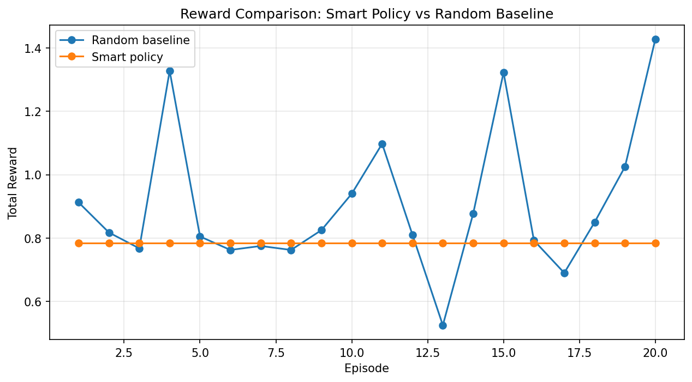
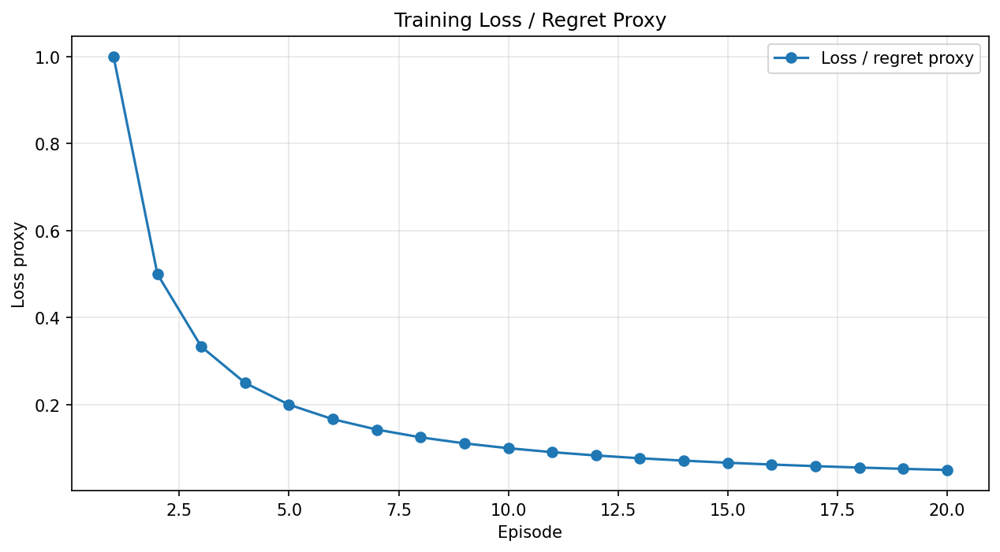
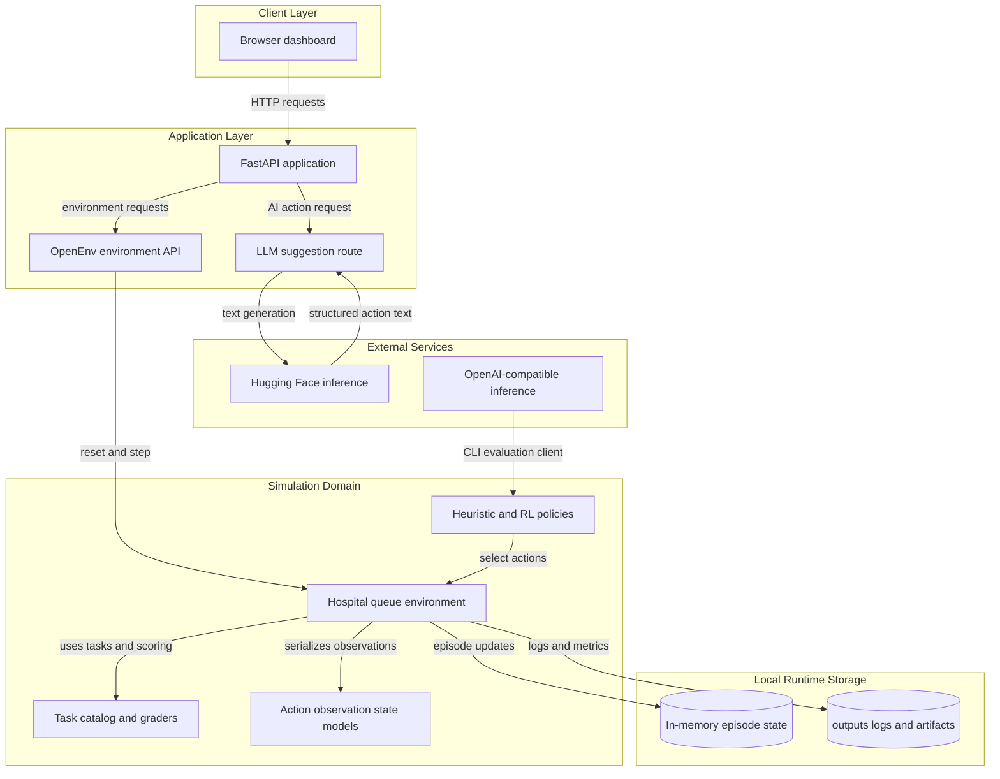
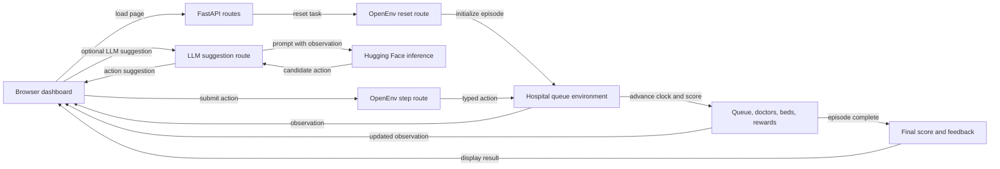

> 🚀 **Real-time hospital triage where AI decisions can save lives**

> This environment teaches AI agents how to make life-critical decisions under constraints — just like real hospital triage systems.

---

## 🚀 Introduction

**MedFlow-OpenEnv** is a realistic simulation environment where AI agents learn to:

- Prioritize patients (emergency, urgent, normal)
- Assign doctors based on specialization
- Manage limited hospital resources (beds, doctors)
- Minimize wait time and prevent critical failures

Unlike toy environments, MedFlow models **real-world healthcare decision-making under pressure**.

---

## ❗ Problem

Hospitals face extreme congestion during peak hours and emergencies.

The challenge:
- Limited doctors and beds
- Patients with different severity levels
- Delays can lead to **critical deaths**

👉 Goal:  
Design an agent that makes **optimal triage decisions under constraints**

---

## 🧠 Environment Design

### 🧾 Observation Space

- Patient queue (priority, severity, wait time)
- Doctors (availability, specialization)
- Bed availability
- Simulation time

---

### 🎮 Action Space

- `assign` → assign patient to doctor  
- `prioritize` → move patient to front  
- `discharge` → free resources  
- `wait` → strategic no-op  

---

### ⚙️ Key Features

- ⏱️ Real-time simulation clock  
- 🏥 Limited beds & doctors  
- 🚑 Emergency handling  
- 📈 Dynamic patient arrivals  
- ⚠️ Critical death penalties  

---

## 🎯 Reward Design

- +0.15 → fast emergency handling  
- +0.10 → efficient urgent handling  
- +0.05 → normal treatment  
- -0.10 → wrong specialization  
- -0.15 → delayed emergency  
- -0.05 → resource overflow  

👉 Designed to encourage **real-world decision-making**

---

## 🧠 What the Agent Learns

Agents trained in MedFlow learn to:

- Prioritize high-risk patients
- Allocate resources efficiently
- Avoid critical failures
- Balance speed vs correctness

👉 These are **real-world decision intelligence skills**

---

## 📊 Learning Evidence (Key Result)

We compare two policies:

| Policy | Avg Reward |
|----------|----------|
| Random Policy | -7.05 |
| Trained Q-Learning Policy | +2.03 |

✅ The trained policy consistently outperforms the random baseline.

📈 Performance Improvement:
- Reward Improvement: **+9.08 points**
- Evaluated across **1,000 training episodes** and **30 evaluation episodes**

> ⚡ The same action can produce different outcomes depending on patient severity, queue length, doctor availability, and timing — similar to real-world hospital operations.

👉 These results demonstrate that the environment supports meaningful learning and policy optimization through reinforcement learning.

---

## 📈 Training Results



> Episode-wise reward showing agent performance



> Training stability over time

---

## 🤖 Decision Strategies

- ⚙️ **Greedy Baseline** → rule-based  
- 🧠 **LLM Agent** → reasoning-based  
- 🤖 **RL Agent** → learning-based  

👉 Shows evolution:
**Rules → Reasoning → Learning**

---

## 🚀 Live Demo

- 🌐 Hugging Face Space:  
  https://huggingface.co/spaces/shriom23/MedFlow-OpenEnv  

- 🖥️ Live App:  
  https://shriom23-medflow-openenv.hf.space/  

---

## 📓 Training Notebook

👉 **Colab Notebook:**  
[Open in Colab](https://colab.research.google.com/drive/1qNCzeWGgPpmK24Q8BlZpGn08Wm_dgtQk?usp=sharing)

---

## 🎥 Demo Video

👉 [YouTube Demo Video](https://youtu.be/Y8rlv3TbmlE?si=d7mc2OUle9TF3upk)

---

## 🚀 Why This is NOT a Toy Environment

MedFlow goes beyond simple simulations:

- Dynamic real-time system
- Multi-objective reward design
- Resource constraints
- Life-critical consequences

👉 Suitable for **serious agent training research**

---

## 🛠️ Tech Stack

- OpenEnv Framework  
- FastAPI backend  
- Python  
- HuggingFace / OpenAI APIs  
- Reinforcement Learning  

---

## System Architecture

MedFlow-OpenEnv is an in-memory hospital triage simulation exposed through a FastAPI application. The browser dashboard uses the OpenEnv environment routes for episode interaction and can request an AI-generated action through the Hugging Face inference client.

<!-- mermaid-checked: no \n, no em-dash/en-dash, no {} in labels, subgraphs are id["label"], arrows are -->|"label"|, all subgraphs closed by end, ids unique -->


### Application Workflow

The following flow describes a typical interactive request. The browser first starts or resets an episode, optionally asks for an LLM suggestion, submits an action, and receives the updated observation and reward. The loop continues until the environment marks the episode complete.

<!-- mermaid-checked: no \n, no em-dash/en-dash, no {} in labels, subgraphs are id["label"], arrows are -->|"label"|, all subgraphs closed by end, ids unique -->


### Component Responsibilities

| Component | Responsibility |
|---|---|
| Browser dashboard | Presents tasks, queue state, doctors, beds, rewards, feedback, and action controls. |
| FastAPI application | Serves the dashboard and exposes health, task, snapshot, recommendation, benchmark, LLM, reset, and log routes. |
| OpenEnv environment API | Supplies the framework-managed reset and step interaction boundary. |
| HospitalQueueEnvironment | Maintains the simulation clock and episode state, processes actions, advances arrivals and treatments, calculates rewards, and ends episodes. |
| Task catalog and graders | Defines the easy, medium, and hard scenarios, patient and doctor data, resource limits, rubrics, and final scoring. |
| Action, observation, and state models | Defines the typed data exchanged between agents, the environment, and API clients. |
| LLM suggestion route | Builds a scheduling prompt, calls Hugging Face inference, validates the returned action shape, and falls back to wait for invalid output or errors. |
| Heuristic and RL policies | Provide local action-selection and evaluation utilities for baseline and training workflows. |
| In-memory episode state | Holds patients, doctors, beds, arrivals, clock values, and episode statistics for the running process. |
| Local output artifacts | Stores JSON logs, plots, benchmark results, and evaluation files under `outputs/`. |

### Technology Choices and Their Purpose

| Technology | Purpose in this project |
|---|---|
| Python 3.10+ | Application, simulation, policies, evaluation, and training implementation. |
| OpenEnv Core | Standardizes the environment server and typed reset/step interaction for AI agents. |
| FastAPI and Uvicorn | Provides the HTTP API, dashboard hosting, health endpoints, and local server runtime. |
| Dataclasses | Models actions, observations, state, patients, doctors, tasks, and scoring configuration without a persistent ORM. |
| Hugging Face inference client | Generates optional natural-language-model action suggestions for the interactive UI. |
| OpenAI-compatible client | Supports the separate CLI inference and baseline evaluation path through a configurable API base URL. |
| Transformers, Datasets, Accelerate, and TRL | Support local model training and evaluation workflows in `train/`. |
| Matplotlib | Produces reward and loss visualizations from training or evaluation outputs. |
| Docker | Packages the FastAPI application and dashboard for deployment on port 7860. |

### Implemented Versus Future Scope

Implemented behavior includes the three simulation tasks, dynamic arrivals where configured, doctor specialization matching, bed limits, reward shaping, critical-death penalties, browser interaction, optional LLM suggestions, baseline policies, and local evaluation artifacts. The repository does not implement user authentication, a database, persistent application state, a production job queue, or external hospital information-system integrations; those should be treated as future extensions rather than current architecture components.

---

## 🚀 How to Run

```bash
pip install -r requirements.txt
python -m server.app
```

---

## 🧠 Key Insight

> 🚀 MedFlow shows how AI can learn to make critical decisions under real-world constraints.